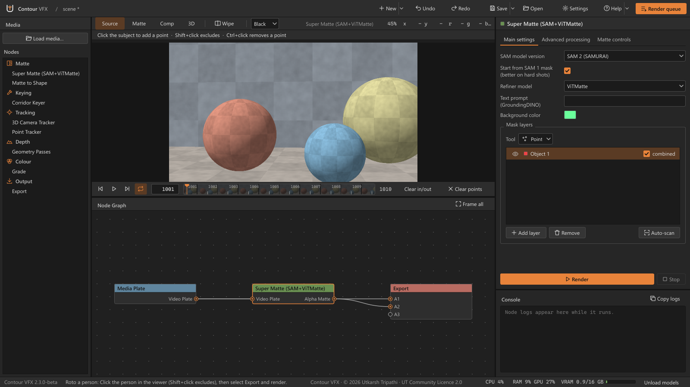
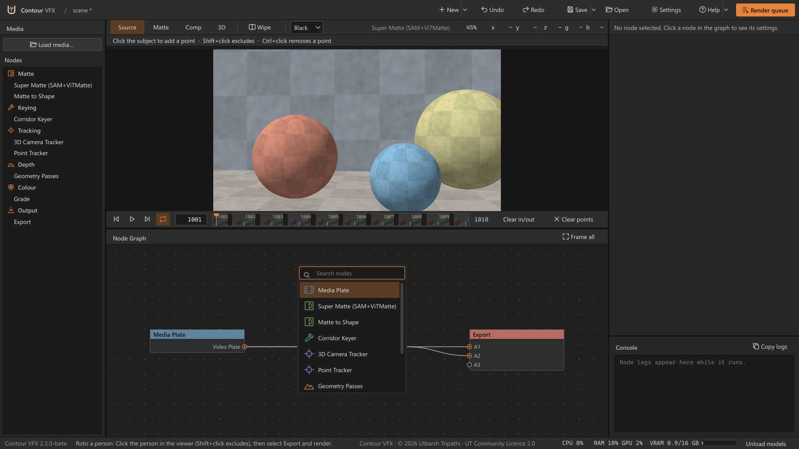
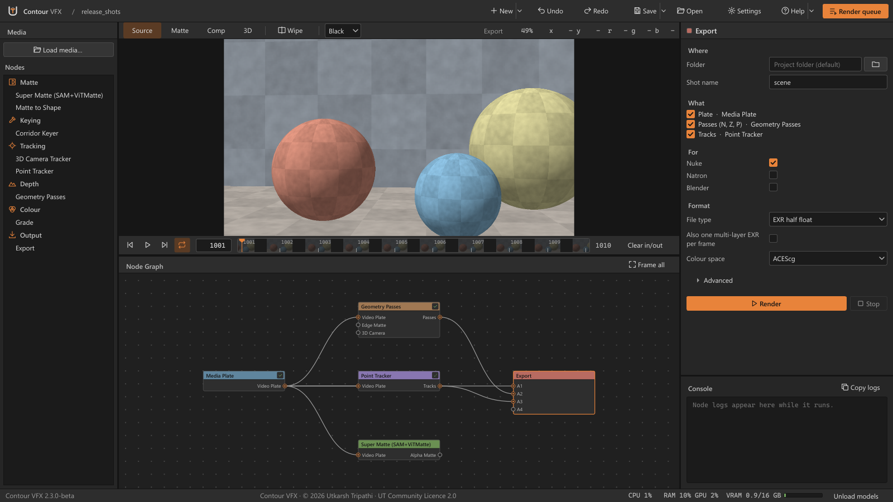
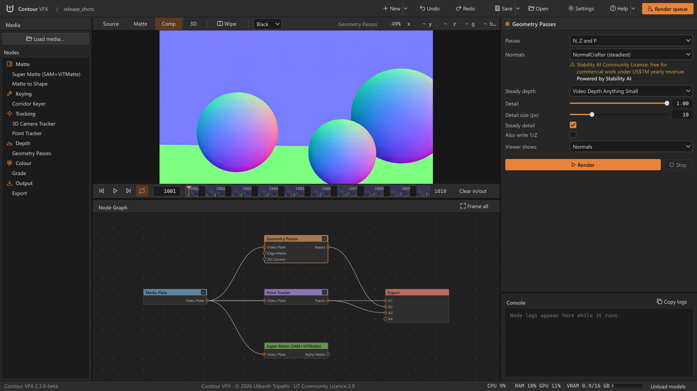
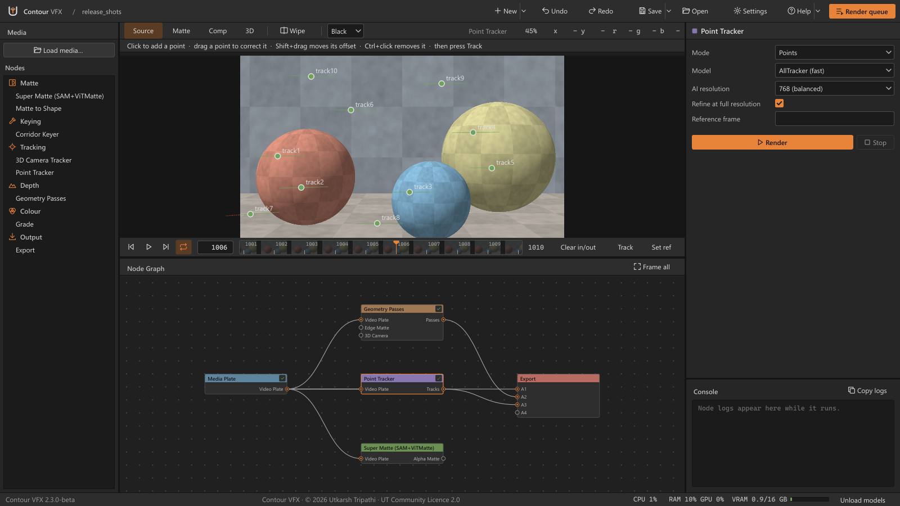
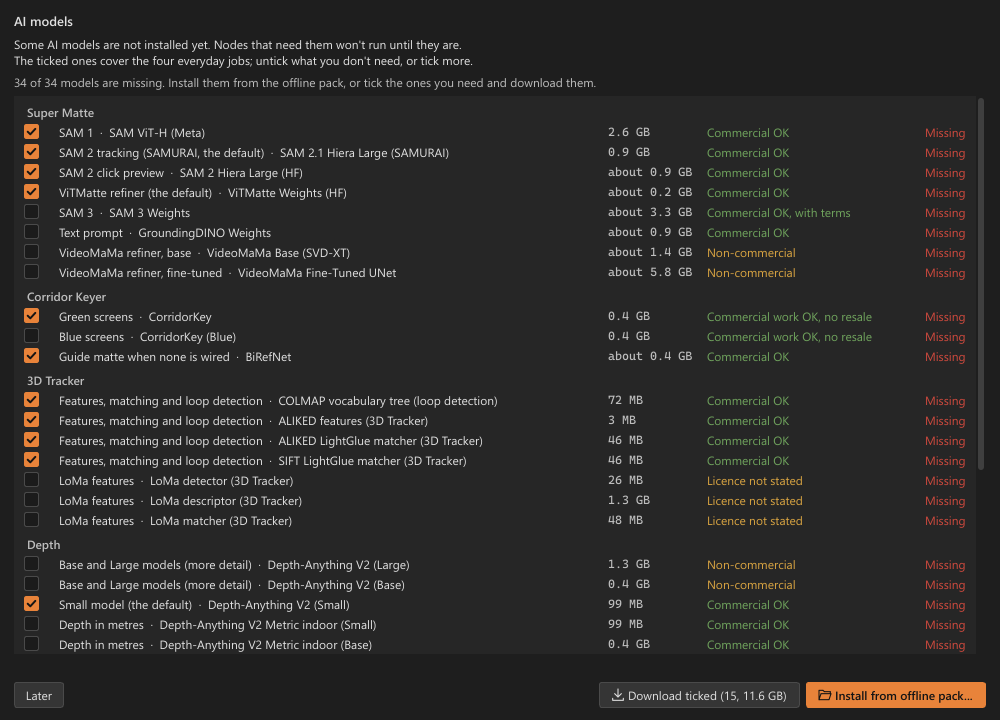

# Contour VFX

A node-based Windows app that runs AI models on your plates (roto, mattes, keying, 2D and 3D tracking) and hands the results to Nuke, Natron and Blender. New in 2.3.0-beta: the **Geometry Passes** node (normals, depth and position passes), the **Point Tracker** node (AI 2D tracks) and the **Export** node, which writes the plate, passes and tracks plus a ready-made Nuke script. Everything runs on your own PC.

## Download

Get the latest setup from **[Releases](https://github.com/capsuleutkarsh-design/ContourVFX/releases/latest)**. Download every file of the release into one folder, then run the `.exe`.

Website and guide: https://capsuleutkarsh-design.github.io/contour-vfx/

## Screenshots

**The main window: a Super Matte roto graph, with the viewer, node list and settings**

**Press Tab in the node graph to search and add any of the nine nodes**

**The Export node: choose where, what (plate, passes, tracks), for which app and in which format**

**Geometry Passes: normals in the viewer, with depth and position passes alongside**

**Point Tracker: AI tracks with their trails, ready for a Tracker4 in Nuke**

**The AI models window on first start: pick what to download, or install from an offline pack**

## Licence

Contour VFX is free to use, made by Utkarsh Tripathi. It is not for sale. Please do not re-upload the setup or remove the author's name. The full licence is shown in the installer.

Questions and bug reports: [capsuleutkarsh@gmail.com](mailto:capsuleutkarsh@gmail.com)
