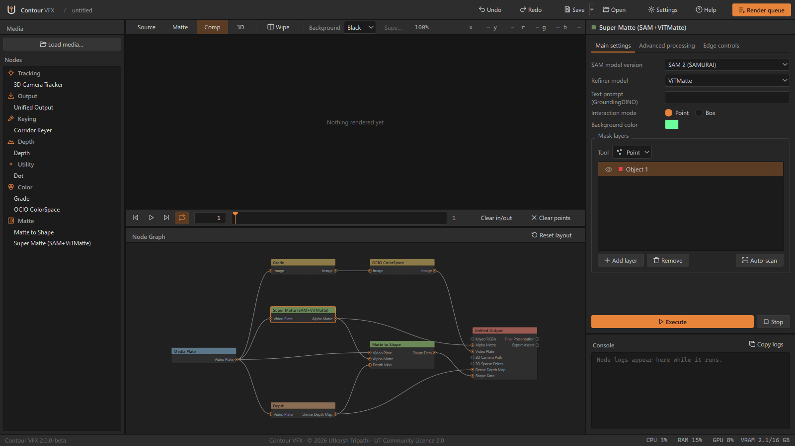
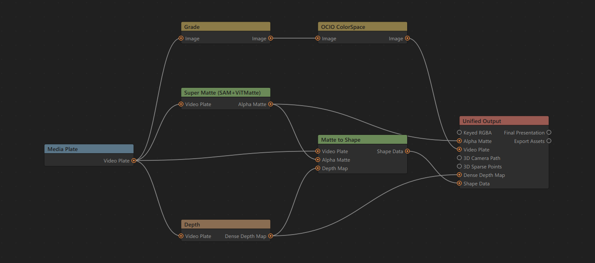
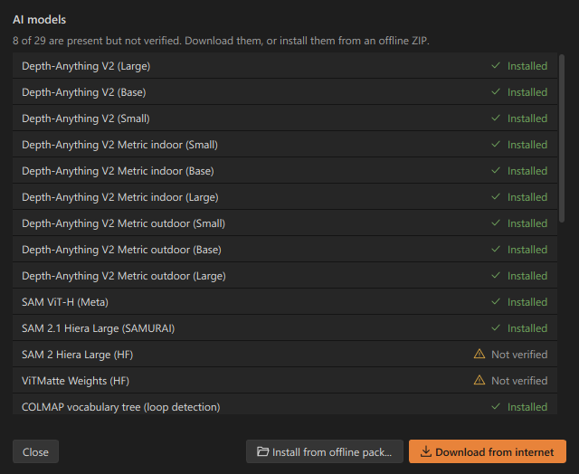
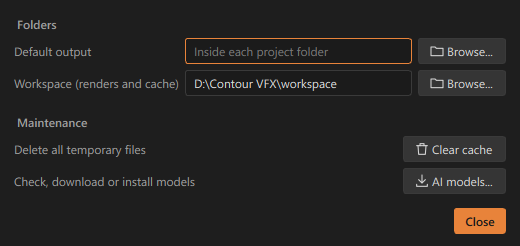

# Contour VFX

A node-based Windows app that runs AI models on your plates (roto, mattes, geometry passes, 2D and 3D tracking) and hands the results to Nuke, Natron and Blender. Everything runs on your own PC.

## Download

Get the latest setup from **[Releases](https://github.com/capsuleutkarsh-design/ContourVFX/releases/latest)**. Download every file of the release into one folder, then run the `.exe`.

Website and guide: https://capsuleutkarsh-design.github.io/contour-vfx/

## Screenshots

**The main window: node graph, viewer and properties**

**A node graph from plate to export**

**The AI models window**

**Settings**

## Licence

Contour VFX is free to use, made by Utkarsh Tripathi. It is not for sale. Please do not re-upload the setup or remove the author's name. The full licence is shown in the installer.

Questions and bug reports: [capsuleutkarsh@gmail.com](mailto:capsuleutkarsh@gmail.com)
